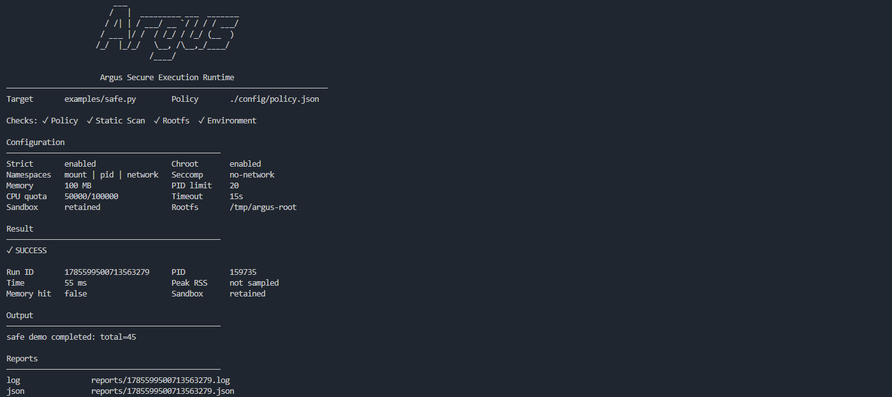

# Argus
### Secure Runtime for AI-Generated & Untrusted Code

<p align="center">
  
</p>

---


## Why Argus?

Modern developers increasingly run code they didn't fully write — AI-generated scripts, open source snippets, unfamiliar automation. Traditional tools force a bad choice:

- **Too heavy** — Docker, VMs, cloud sandboxes. Massive overhead for running a single script.
- **Too naive** — running `python script.py` with no visibility into what it's actually doing.

Argus sits in the middle. Lightweight enough to wrap any script execution. Intelligent enough to catch dangerous behavior before and during runtime — and explain exactly what it was trying to do.

```bash
argus run scripts/suspicious.py
```
```
⚠ Strict mode enabled. Execution blocked due to suspicious patterns.

Analysis:
- Pattern: subprocess.Popen
  Risk: HIGH
  Intent: Subprocess abuse
  Explanation: Script spawns external child processes.
```

---

## Features

### v0.1 Capability Checklist

- [x] Static malware scanning
- [x] Behavior analysis
- [x] Chroot isolation
- [x] Mount namespace
- [x] PID namespace
- [x] Network namespace
- [x] cgroup v2
- [x] Memory limits
- [x] CPU quota
- [x] Process limits
- [x] Seccomp syscall filtering
- [x] JSON reports
- [x] CLI interface
- [x] Doctor diagnostics
- [x] Sandbox inspection

### Static Analysis (SAST-lite)
Scans scripts for dangerous patterns before a single line executes. Depending on policy, Argus warns, prompts for confirmation, or blocks outright.

Detected patterns include:

| Pattern | Risk | Intent |
|---|---|---|
| `os.system` | HIGH | Shell command execution |
| `subprocess.Popen` | HIGH | Subprocess abuse |
| `socket.connect` | HIGH | Raw network socket |
| `open('~/.ssh` | HIGH | Credential harvesting |
| `rm -rf` | HIGH | Destructive file operation |
| `requests.get` | MEDIUM | Outbound HTTP call |
| `open('/etc/` | MEDIUM | System file access |

### Behavioral Intent Analysis
Argus doesn't just say `BLOCKED` — it explains *why*. Every detected pattern maps to a structured analysis: risk level, intent classification, and a plain-English explanation written to the execution report.

### Runtime Monitoring
Scripts run inside a controlled Go execution context with:
- **PID tracking** — process identity from start to finish
- **Start / end / duration** — full execution timeline
- **Peak memory tracking** — polls `/proc/<pid>/status` every 100ms, tracks true peak VmRSS across the full execution window
- **Memory limit enforcement** — kills the process and its entire process group when the policy threshold is exceeded

### Process Tree Monitoring
Argus watches for child processes spawned during execution:
- Reads `/proc/<pid>/task/<pid>/children` on every poll tick
- Captures child PID, process name, and full command line
- Maintains a `ChildHistory` — tracks processes even after they exit between ticks
- Deduplicates suspicious detections using stable `PID:Name` keys
- Flags known suspicious processes by name (`bash`, `sh`, `curl`, `wget`, `nc`) and by command pattern (`bash -c`, `python3 -c`, `/dev/tcp`, etc.)

### Policy Engine
All behavior is driven by `config/policy.json` — not hardcoded logic:

```json
{
    "timeout": 15,
    "strict_mode": true,
    "blocked_patterns": [
        "os.system",
        "subprocess.Popen",
        "requests.get",
        "open('/etc/",
        "open('~/.ssh",
        "socket.connect",
        "rm -rf"
    ],
    "memory_limit_mb": 100,
    "pids_limit": 20,
    "cpu_quota": 50000,
    "cpu_period": 100000,
    "keep_sandbox": true,
    "rootfs_path": "/tmp/argus-root",
    "enable_chroot": true,
    "enable_seccomp": true,
    "seccomp_profile": "no-network"
}
```

| Field | Description |
|---|---|
| `timeout` | Maximum execution time in seconds |
| `strict_mode` | `true` blocks on any detected pattern; `false` prompts the user |
| `blocked_patterns` | List of patterns the static scanner checks |
| `memory_limit_mb` | Memory ceiling — process is killed if exceeded |
| `pids_limit` | cgroup process ceiling via `pids.max` |
| `cpu_quota` / `cpu_period` | cgroup CPU quota via `cpu.max` |
| `enable_chroot` | Runs scripts inside the configured root filesystem |
| `enable_seccomp` | Applies the selected seccomp syscall profile |
| `seccomp_profile` | Seccomp profile name, such as `no-network` |

### Structured Execution Reports
Every run produces a timestamped report file — never overwriting previous runs:

```
reports/
  run_2026-05-25T10-43-02.825_BLOCKED_BY_POLICY.log
  run_2026-05-25T10-47-06.716_SUCCESS.log
  run_2026-05-25T10-51-33.102_MEMORY_LIMIT_EXCEEDED.log
```

Each report contains: script path, status, output, execution time, PID, start/end timestamps, memory results, child process history, and behavioral analysis.

### Process Group Kill
When a timeout or memory violation occurs, Argus kills the entire process group — not just the parent script. Child processes cannot outlive their parent and continue running as orphans.

---

## Execution Outcomes

| Status | Meaning |
|---|---|
| `SUCCESS` | Script completed within all policy limits |
| `TIMEOUT` | Script exceeded the allowed execution time |
| `ERROR` | Script crashed or exited with a non-zero code |
| `BLOCKED_BY_POLICY` | Blocked before execution — strict mode + suspicious pattern |
| `BLOCKED_BY_USER` | User declined to proceed when prompted |
| `MEMORY_LIMIT_EXCEEDED` | Process killed for exceeding memory policy |
| `SECURITY_VIOLATION` | Runtime security enforcement blocked the script |

---

## Architecture

```
argus run script.py
        │
        ▼
  Load Policy                 config/policy.json
        │
        ▼
  Static Scanner              pattern matching against blocked list
        │                     → behavioral intent analysis
        ▼
  Execution Engine            Go runtime with context timeout
        │                     process group isolation (Setpgid)
        │                     chroot + mount/PID/network namespaces
        ▼
  Runtime Monitor             /proc polling goroutine (100ms)
        │                     peak memory tracking
        │                     child process tree inspection
        │                     suspicious process classification
        ▼
  Enforcement Layer           cgroup memory/PID/CPU controls
        │                     seccomp syscall filtering
        │                     kill on memory violation
        │                     kill on timeout
        │                     SIGKILL to process group (-pid)
        ▼
  Logger & Reporter           timestamped JSON-structured report
                              full audit trail, never overwritten
```

---

## Project Structure

```
Argus/
├── main.go                         # CLI entrypoint
├── config/
│   └── policy.json                 # Execution policy
├── internal/
│   ├── behavior/
│   │   └── behavior.go             # Behavioral intent analysis
│   ├── logger/
│   │   └── logger.go               # Report writing
│   ├── monitor/
│   │   └── monitor.go              # /proc polling, child tree, suspicious detection
│   ├── policy/
│   │   └── policy.go               # Policy loading
│   ├── runner/
│   │   └── runner.go               # Execution engine
│   └── scanner/
│       └── scanner.go              # Static pattern scanner
├── scripts/                        # Test scripts
│   ├── test.py
│   ├── long.py                     # Timeout test
│   ├── memory_test.py              # Memory limit test
│   ├── child_test.py               # Child process test
│   ├── child_no_flag.py            # Child process (no blocked patterns)
│   └── suspicious_child_test.py   # Suspicious child detection test
├── examples/                       # Controlled demo scripts
│   ├── safe.py
│   ├── timeout.py
│   ├── memory.py
│   ├── network.py
│   ├── process_limit.py
│   └── suspicious.py
├── reports/                        # Timestamped execution reports
└── logs/
```

---

## Getting Started

### Prerequisites
- Go 1.21+
- Linux (uses `/proc` filesystem)
- Python 3 (for running `.py` scripts)

### Installation

```bash
git clone https://github.com/sanuthmee1578/Argus.git
cd Argus
go build -o argus .
```

### Usage

```bash
# Run a script through Argus
./argus run scripts/test.py

# Run a script that will be blocked by policy
./argus run scripts/suspicious_child_test.py

# Run a script that triggers memory enforcement
./argus run scripts/memory_test.py

# Run a script and observe child process monitoring
./argus run scripts/child_no_flag.py
```

### Controlled Examples

The `examples/` folder contains documented demos for success, timeout, memory
limit, runtime network enforcement, process limit enforcement, and suspicious
static-pattern detection.

```bash
./argus run examples/safe.py
./argus run examples/timeout.py
./argus run examples/memory.py
./argus run examples/network.py
./argus run examples/process_limit.py
./argus run examples/suspicious.py
```

### Terminal Screenshots

`argus doctor`

```text
Environment check
────────────────────────────────────────
[PASS] Linux operating system      linux/amd64
[PASS] Policy configuration        ./config/policy.json
[PASS] cgroup v2                   /sys/fs/cgroup/cgroup.controllers
[PASS] Rootfs directory            /tmp/argus-root
[PASS] Rootfs validation           required runtime files are available
[PASS] Python runtime              /tmp/argus-root/usr/bin/python3
[PASS] Seccomp execution helper    /tmp/argus-root/usr/local/bin/argus-exec
[PASS] libseccomp runtime          /tmp/argus-root/lib/x86_64-linux-gnu/libseccomp.so.2
[PASS] /dev/null device            /tmp/argus-root/dev/null
[PASS] Current privileges          root privileges available

Argus is ready to execute workloads.
```

`argus run examples/safe.py`

```text
                                    ___
                           /   |  _________ ___  _______
                          / /| | / ___/ __ `/ / / / ___/
                         / ___ |/ /  / /_/ / /_/ (__  )
                        /_/  |_/_/   \__, /\__,_/____/
                                    /____/

                      argus secure execution runtime
────────────────────────────────────────────────────────────────────────
Target       examples/safe.py        Policy       ./config/policy.json

Checks: ✓ Policy  ✓ Static Scan  ✓ Rootfs  ✓ Environment

Configuration
────────────────────────────────────────────────
Strict       enabled                 Chroot       enabled
Namespaces   mount | pid | network   Seccomp      no-network
Memory       100 MB                  PID limit    20
CPU quota    50000/100000            Timeout      15s
Sandbox      retained                Rootfs       /tmp/argus-root

Result
────────────────────────────────────────────────
✓ SUCCESS

Run ID       1785590000000000000     PID          93890
Time         29 ms                   Peak RSS     not sampled
Memory hit   false                   Sandbox      retained

Output
────────────────────────────────────────────────
safe demo completed: total=45
```

`argus run examples/memory.py`

```text
Result
────────────────────────────────────────────────
✗ MEMORY_LIMIT_EXCEEDED
Reason             Execution exceeded the configured memory limit

Run ID       1785590000000000000     PID          94120
Time         842 ms                  Peak RSS     104 MB
Memory hit   true                    Sandbox      retained
```

`argus run examples/network.py`

```text
Result
────────────────────────────────────────────────
✗ SECURITY_VIOLATION
Reason             Network syscall blocked by seccomp

Run ID       1785590000000000000     PID          94418
Time         45 ms                   Peak RSS     < 1 MB
Memory hit   false                   Sandbox      retained

Output
────────────────────────────────────────────────
attempting one outbound socket operation
PermissionError: [Errno 1] Operation not permitted
```

`argus run examples/process_limit.py`

```text
Output
────────────────────────────────────────────────
starting up to 48 child processes
started child 1: pid=...
...
fork failed at child 18: [Errno 11] Resource temporarily unavailable
process-limit demo completed: children_started=18
```

`argus scan examples/suspicious.py`

```text
Static security scan
────────────────────────────────────────
Target: examples/suspicious.py

Result: SUSPICIOUS
Warnings: 1

  1. os.system

Behavior analysis

  HIGH    Shell execution
          Pattern: os.system
          Script may execute arbitrary system commands.

Policy decision: execution would be blocked in strict mode.
```

### Configure Policy

Edit `config/policy.json` to adjust behavior:

```json
{
    "timeout": 30,
    "strict_mode": false,
    "memory_limit_mb": 100
}
```

Set `strict_mode: false` to prompt instead of block, increase `timeout` for longer scripts, raise `memory_limit_mb` for memory-intensive workloads.

---

## Versioning Roadmap

| Version | Capability | Status |
|---|---|---|
| **V1** | Static scanning, policy engine, execution with timeout, structured reports |  Complete |
| **V1.5** | PID tracking, `/proc` polling, peak memory monitoring, memory enforcement, process group kill |  Complete |
| **V2 (current)** | Process tree monitoring, child history, suspicious process detection, behavioral intent analysis |  Complete |
| **V2.5** | CPU usage monitoring and enforcement |  In progress |
| **V3** | Linux sandboxing — cgroups v2, seccomp syscall filtering, namespace isolation |  Planned |
| **V3.5** | CI/CD integration, GitHub Action, local dashboard |  Planned |

---

## Why Not Just Docker?

Docker solves a different problem — it isolates environments for deployment. Argus is built specifically for **execution safety**:

| | Argus | Docker |
|---|---|---|
| Setup overhead | Zero — single binary | Image build + daemon |
| Use case | Safe script execution | Environment isolation |
| Behavioral explanation | Yes — intent analysis | No |
| Process tree inspection | Yes — per-tick `/proc` polling | No |
| Target workflow | AI-generated code, untrusted scripts | Application deployment |

---

## Technical Highlights

- **Concurrent monitoring** — `/proc` polling runs in a goroutine alongside execution, communicating via Go channels (`done`, `memoryExceededChan`, `monitorResultsChan`)
- **True peak memory** — compares every VmRSS sample against a running peak, not a snapshot at start or end
- **Child history persistence** — child process commands are cached in a map on first detection, preserving them even after the child process exits between poll ticks
- **Stable deduplication** — suspicious processes deduplicated using `PID:Name` composite key to prevent duplicate alerts across ticks
- **Process group enforcement** — `Setpgid: true` + `syscall.Kill(-pid, SIGKILL)` ensures the entire spawned process tree is terminated on violation, not just the parent

---

## Built With

- [Go](https://golang.org/) — runtime, concurrency, process control
- Linux `/proc` filesystem — process introspection without external dependencies
- `syscall` package — process group management, signal delivery

---

## Author

**Sanuthmee** — [@sanuthmee1578](https://github.com/sanuthmee1578)

> Built as a systems security project exploring safe execution environments for AI-generated code.
